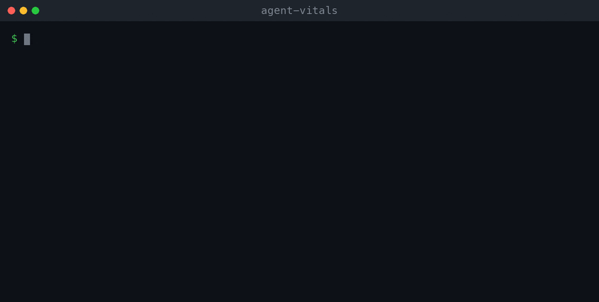

# AgentVitals

A live dashboard for your AI coding agent session. See tokens in and out, estimated cost,
and how full the context window is, while you keep working in another terminal.

Coding agents hide how much context you have burned until the session degrades or hits the limit.
AgentVitals reads Codex's notify hook and keeps a running tally you can glance at.



## Install

AgentVitals is not on PyPI. The `agent-vitals` package there is an unrelated project.
Install from source:

```bash
pip install git+https://github.com/Kipung/AgentVitals
```

Then follow the Codex setup below.

## Features

- Live token accounting split by input/output
- Estimated session cost by model pricing table
- Context window tracking with overflow detection
- Session throughput (`tokens/min`) and response-time stats

## Recommended: Passive Second-Window Tracking (Codex)

Keep using Codex normally in one terminal, and run vitals in a separate terminal.

1. Make the bridge executable:

```bash
chmod +x examples/codex_vitals_bridge.sh
BRIDGE_PATH="$(realpath examples/codex_vitals_bridge.sh)"
```

2. Add the bridge to `~/.codex/config.toml`:

```toml
notify = [
  "/absolute/path/to/examples/codex_vitals_bridge.sh"
]
```

3. In another terminal, start the live dashboard:

```bash
agent-vitals watch
```

Optional overrides:

```bash
export AGENT_VITALS_MODEL=gpt-4-turbo
export AGENT_VITALS_STATE_FILE=~/.agentvitals/codex_state.json
export AGENT_VITALS_EVENTS_FILE=~/.agentvitals/codex_events.jsonl
```

## Commands

- `agent-vitals watch`
- `agent-vitals codex-hook`
- `agent-vitals reset`
- `agent-vitals run -- <cmd...>` (explicit wrapper mode)

## Wrapper Mode (Legacy/Optional)

```bash
agent-vitals --model gpt-4-turbo --context-window 128000 python my_agent.py
```

Notes:
- `--model` is used for price/context lookups (and can be set via `AGENT_VITALS_MODEL`).
- `--context-window` overrides model defaults if you want strict custom tracking.
